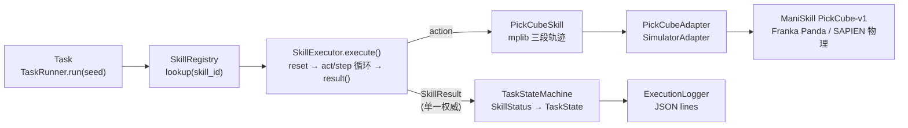
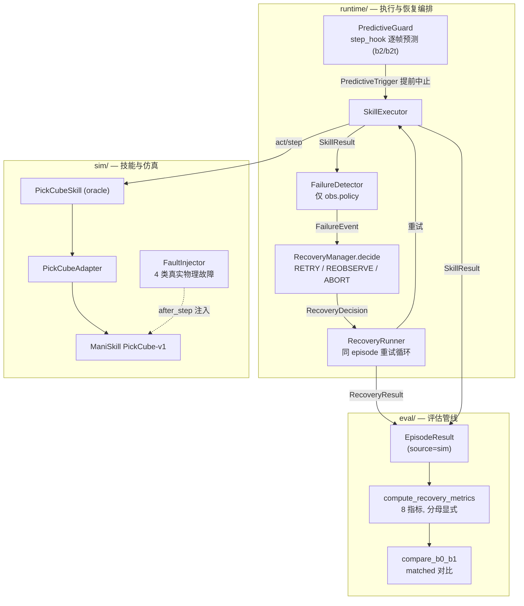

# Architecture — Robotic Skill Harness

> 本文档（M6-B）基于真实代码重写，逐条对齐 `interfaces/`、`runtime/`、`sim/`、`eval/`、`learning/` 的实际实现。
> 未经验证的结论不写入本文。里程碑的实测结果见 `docs/PROJECT_STATUS.md`、`docs/M5_RESULTS.md`、`docs/BENCHMARK_PROTOCOL.md`。

## 1. 顶层目标与范围

可复现的机器人操作（manipulation）系统：ManiSkill3 + Franka Panda（PickCube-v1），
覆盖「技能执行 → 故障注入 → 失败检测 → 规则式恢复 → 学习预判（M4/M5）→ 自动基准评估」全链路。

**本项目的原创贡献边界（不夸大）**：

- 本项目实现：技能接口契约、执行编排（executor/harness/恢复循环）、任务与恢复状态机、
  真实物理故障注入、规则式失败检测、恢复决策、学习预测器的运行时集成、结构化日志、评估管线与指标。
- 继承自第三方（非本项目实现，不声称原创）：
  - **ManiSkill**：环境 `PickCube-v1`、仿真封装（`gym.make`）。
  - **SAPIEN**：底层物理引擎（刚体动力学、接触、正积分）。
  - **mplib**：运动规划（`plan_screw`）、抓取位姿计算（`compute_grasp_info_by_obb` / `get_actor_obb`）。
- `PickCubeSkill` 的「技能原创性」在于**接口符合性 + 三段轨迹编排**（reach→grasp→goal），
  其规划算法本身是 mplib，不是本项目实现。

---

## 2. 仓库布局

```
robotic-skill-harness/
├── docs/                  # PROJECT_SPEC / ARCHITECTURE / INTERFACES / PROJECT_STATUS / M5_RESULTS ...
├── interfaces/            # 共享契约（冻结后由 Lead 维护）
│   ├── observation.py     #   PolicyObservation / GroundTruth / RobotObservation
│   ├── skill.py           #   RobotSkill / SkillResult / SkillStatus
│   ├── adapter.py         #   SimulatorAdapter / EpisodeInfo / StepResult
│   ├── failure.py         #   FailureType / FailureEvent
│   ├── fault.py           #   FaultRecord
│   ├── recovery.py        #   RecoveryAction / RecoveryDecision / RecoveryResult
│   ├── episode.py         #   EpisodeResult / EpisodeMetrics
│   └── learning.py        #   STATE_FEATURE_NAMES / extract_state_features / FailurePredictor
├── runtime/               # Agent B：执行编排 + 检测 + 恢复 + 预判 + 日志
│   ├── registry.py        #   SkillRegistry
│   ├── executor.py        #   SkillExecutor
│   ├── harness.py         #   TaskRunner / TaskRunResult
│   ├── state_machine.py   #   TaskState / TaskStateMachine
│   ├── failure_detector.py#   FailureDetector
│   ├── recovery.py        #   RecoveryManager / RecoveryRunner / RecordingAdapter
│   ├── predictive.py      #   PredictiveGuard / TemporalGate / RecoveryMode
│   └── logger.py          #   ExecutionLogger（JSON lines）
├── sim/                   # Agent A：ManiSkill 集成 + 技能 + 故障注入
│   ├── pickcube_adapter.py#   PickCubeAdapter
│   ├── pick_skill.py      #   PickCubeSkill（mplib 运动规划基线）
│   └── fault_injection.py #   FaultInjector（4 类真实物理故障）
├── learning/              # Agent C：MLP 失败预测（M4 启用）
│   └── model.py           #   MLP / MLPFailurePredictor
├── eval/                  # Agent D：基准 + 故障注入消费 + 学习评估
│   ├── fault_injection.py #   compute_recovery_metrics
│   ├── recovery_benchmark.py # compare_b0_b1
│   ├── learning_split.py  #   episode 级切分
│   ├── learning_metrics.py#   帧级指标
│   └── learning_baselines.py
└── scripts/               # verify_m0..m5 等复现脚本
```

---

## 3. 架构图（Mermaid，仓库友好）

### 3.1 主链路



### 3.2 故障检测 / 恢复 / 评估全链路



**链路说明**：`Task → SkillExecutor → PickCubeSkill → ManiSkill → SkillResult → RecoveryManager → Evaluation`。
`SkillResult` 是执行层唯一权威结果；`RecoveryResult` 是恢复层唯一汇总结果；`EpisodeResult(source=sim)`
是评估层消费的唯一 episode 记录。三者层层汇聚，不交叉判定。

---

## 4. 组件逐个说明

### 4.1 `RobotSkill`（`interfaces/skill.py`）
可执行技能的统一接口。`act` 返回与 `SimulatorAdapter.action_space` 匹配的动作（numpy）。
- `skill_id`：注册表键（字符串）。
- `privileged_access: bool`：特权真值访问声明。`False`（默认）＝观测型策略，**严禁**访问 `obs.truth`；
  `True`＝oracle/状态基线，可用特权位姿规划 + `truth.success` 判成功（须显式标注）。
- `reset(obs)`：进入新 episode 时重置技能内部状态。
- `act(obs) -> action`：根据观测返回一步动作。
- `is_done -> bool`：技能是否已完成（成功或失败）。
- `result(final_obs=None) -> SkillResult`：技能的**权威执行结果**。幂等（多次调用一致、无副作用）。
  返回值 status 只能是 `SUCCESS` 或 `FAILURE`（`TIMEOUT`/`ABORTED` 由 executor 产生）。

### 4.2 `SimulatorAdapter`（`interfaces/adapter.py`）
ManiSkill 环境的统一封装，屏蔽具体 env 细节。方法：`reset` / `step` / `close`；属性：`num_envs`、
`action_space`、`max_episode_steps`。
- **批量张量约定（由 adapter 负责）**：torch 张量 → numpy；单环境去掉 batch 维；多环境保留 `[num_envs, ...]`。
- 终止语义三者独立：`terminated`（环境判定 episode 结束）、`truncated`（horizon 截断）、
  `success`（任务真值）——三者不得混用。

### 4.3 `SkillRegistry`（`runtime/registry.py`）
按 `skill_id` 注册/查找/列出技能。重复注册抛 `DuplicateSkillError`；查找缺失抛 `SkillNotFoundError`。
`list_skills()` 返回排序后的 id。harness/恢复循环经注册表取技能（单一来源，避免绕过）。

### 4.4 `SkillExecutor`（`runtime/executor.py`）
执行一个 `RobotSkill` 直到 `is_done` 或 env 提前结束。`execute()` 循环：`act → adapter.step`。
**SkillResult 的产生者（单一权威）**：
- 技能完成 / env 提前终止截断 → `skill.result(final_obs)`（技能自报 SUCCESS/FAILURE，executor 不看 `truth.success`）。
- 步数预算耗尽 → `TIMEOUT`（`FailureType.TIMEOUT`）。
- `abort_check()` 返回 True → `ABORTED`。
- `skill.act` 抛异常 → `FAILURE`（`FailureType.MOTION_FAIL`）。
- `step_hook` 返回非 None（学习预判触发）→ 提前中止，`FAILURE` + `FailureType.UNKNOWN` + `detail.predictive=True`。
- 附加状态：`last_episode`（最近 `EpisodeInfo`，供 harness 取环境真值）、`total_reward`（累计 reward）。
- mock 模式：不传 adapter 时观测不推进，技能自行维护 `is_done`（开发期用）。

### 4.5 `TaskStateMachine`（`runtime/state_machine.py`）
任务状态机。`TaskState ∈ {IDLE, RUNNING, SUCCESS, FAILURE, TIMEOUT, ABORTED}`。
合法转移：`IDLE → RUNNING/ABORTED`；`RUNNING → 4 终态`；终态无出边。非法转移抛 `InvalidTransitionError`。
`apply_skill_result(result)` 由 `SkillResult.status` 经 `skill_status_to_task_state` 推导目标态。

### 4.6 `FailureDetector`（`runtime/failure_detector.py`）
规则式失败检测，**只用可观测信息（`obs.policy`），严禁读 `obs.truth`**。确定性（相同输入→相同输出）。
- `validate_observation`：观测损坏 → `INVALID_OBS`（NaN/Inf、缺失字段、gripper 越界、时间戳异常）。
- `detect_policy_anomaly`：可观测异常启发式 —— `COLLISION`（|qvel| 突增 / TCP 位移跳变）、
  `DROP`（曾处抓取窗后滑脱）、`GRIP_FAIL`（抓手全闭夹空）。
- `detect()`（权威入口）：优先级 `INVALID_OBS`（硬信号）> 技能/executor 自报 failure > 可观测启发式 >
  无具体类型 → `UNKNOWN`。`SUCCESS` 仍校验观测完整性；`ABORTED` 不算可恢复失败。
- 阈值全部可覆盖（`FailureDetectorConfig`）。

### 4.7 `RecoveryManager`（`runtime/recovery.py`）
规则式恢复决策器（确定性，不依赖 LLM）。`decide(failure, retry_count, env_ended)` → `RecoveryDecision`：
- `env_ended` → `ABORT`（同 episode 内无法恢复）。
- `retry_count >= max_retries` → `ABORT`（重试预算耗尽）。
- `failure.type ∈ abort_on`（默认 `RECOVERY_EXHAUSTED`）→ `ABORT`；`∈ reobserve_on`（默认 `INVALID_OBS`）→ `REOBSERVE`；其余 → `RETRY`。
- **有界重试**：`max_retries` 默认 2，总尝试次数 = 1 + max_retries。

### 4.8 `PredictiveGuard`（`runtime/predictive.py`）
把 M4 训练出的 `FailurePredictor` 接入恢复编排的运行时守卫。`step_hook` 逐帧调用
`predictor.predict(extract_state_features(obs))`，当 `prob >= threshold` 且 `confidence >= min_confidence`
且时序门控放行时返回 `PredictiveTrigger`，由 executor 提前中止当前 attempt，交 RecoveryRunner 走
既有规则恢复（**不产动作、不改 env、不绕过 `max_retries`**）。任何推理异常/无效输入/低置信度
→ 回退规则式行为（记录 error，返回 None）。
- `RecoveryMode`：`b1`（纯规则）/ `b2`（规则+单帧预判）/ `b2t`（规则+预判+时序门控）。
- `TemporalGateMode`：`NONE`/`DEBOUNCE`/`PHASE`/`COOLDOWN`/`ADVISORY`。冻结变体 `FROZEN_B2T_GATE`（phase 门控）。

### 4.9 任务/episode 驱动（`TaskRunner` 与 `RecoveryRunner`，`runtime/harness.py` + `runtime/recovery.py`）
> 说明：代码中无名为 `EpisodeRunner` 的类；episode 驱动由两个类承担——`TaskRunner`（单次执行，无恢复）
> 与 `RecoveryRunner`（同 episode 内执行+检测+恢复循环）。

- **`TaskRunner`**：装配 `adapter + skill + registry + executor + state_machine + logger`。
  `run()` = registry 查技能 → executor 执行 → 状态机推进 → 落一条 trace。**只负责装配+编排+透传**，
  成败判定完全交给 executor，不读 truth 二次判定、不重算 SkillResult。
  `TaskRunResult.to_episode_result()` 的 `success` 字段 = env 特权真值（`episode.success`），
  与 `skill_result.status` 独立，供下游核对「技能自报」与「观测结果」是否一致。
- **`RecoveryRunner`**：单一 episode 内编排 `执行 → 检测 → 恢复决策 → 重试` 全链路，产出唯一 `RecoveryResult`。
  关键约束：**只 reset 一次 env**（重试仅 `skill.reset`）；terminated/truncated 后不再重试；
  每次尝试产恰好一个权威 `SkillResult`，多次尝试汇总为唯一 `RecoveryResult`。

### 4.10 Evaluation pipeline（`eval/`）
- `eval/fault_injection.py`：故障注入 episode 的消费与恢复指标计算（`compute_recovery_metrics`，
  8 指标显式定义分母 + 同时返回 numerators/denominators）；`failure_manifested`（失败是否真实发生）、
  `is_valid_injected_failure`（注入成功且失败真实发生，恢复成功率只在此子集上度量）。
- `eval/recovery_benchmark.py`：`compare_b0_b1` matched 对比（matched 键 = task_id/seed/fault_type/frozen params/privileged_access）。
- `eval/learning_split.py`：episode 级切分（seed 原子性、held-out 扰动配置、防泄漏）。
- `eval/learning_metrics.py`：帧级指标（precision/recall/F1/PR-AUC/FP/FN/latency/lead time，分母显式）。
- `eval/learning_baselines.py`：Majority / Rule / Learned 三基线，统一 `FailurePredictor` 接口。
- `eval/source.py`：`require_sim` 守卫（严禁 mock 结果冒充 benchmark 表现）。
- `eval/serialization.py`：episode 结果序列化/反序列化。

---

## 5. 完整执行生命周期

```
1. Task 入口          TaskRunner.run(seed=..., options=...) 或 RecoveryRunner.run(...)
2. 环境 reset          adapter.reset()（RecoveryRunner 用 RecordingAdapter 包装，全程仅此一次）
3. 技能查询            registry.lookup(skill_id)
4. 技能执行            SkillExecutor.execute(skill, obs, ...)
                          ├─ skill.reset(obs)  # 每次 attempt 重置技能（不 reset env）
                          ├─ 循环: skill.act(obs) → adapter.step(action)
                          ├─ 学习预判: PredictiveGuard.step_hook(obs)（仅 b2/b2t）
                          └─ 终止条件: is_done / env terminated|truncated / budget / abort_check / 预判触发
5. 权威结果            SkillResult = skill.result(final_obs)（技能自报 SUCCESS/FAILURE）
                      （TIMEOUT/ABORTED/异常由 executor 产生）
6. 状态机              TaskStateMachine.apply_skill_result(SkillResult) → TaskState
7. 失败检测（恢复路径）  FailureDetector.detect(SkillResult, final_obs, obs_history) → FailureEvent | None
8. 恢复决策            RecoveryManager.decide(failure, retry_count, env_ended) → RETRY/REOBSERVE/ABORT
9. 重试 / 中止          RETRY/REOBSERVE → 回到步骤 4（同 episode，仅 skill.reset）
                      ABORT → 结束
10. 汇总               RecoveryResult(attempts, final_skill_result, decisions, recovered, aborted)
11. 日志                ExecutionLogger：每步 trace（skill_attempt / recovery_decision / recovery_result）
12. 评估                EpisodeResult(source=sim) → compute_recovery_metrics / compare_b0_b1
```

数据流单元：
- `RobotObservation`（`policy` + `truth`）在 `adapter → executor → skill` 间流动。
- `SkillResult` 从 executor 流出（唯一权威）。
- `FailureEvent` 从 detector 流出；`RecoveryDecision` 从 manager 流出；`RecoveryResult` 从 runner 流出。
- `EpisodeResult(source=sim)` 是评估层唯一消费记录。

---

## 6. 契约与语义文档

### 6.1 单一权威结果（`RobotSkill.result()`）
`RobotSkill.result(final_obs=None)` 是技能结果的唯一权威来源。规则：
- 返回值 status 只能是 `SUCCESS` / `FAILURE`；`TIMEOUT`/`ABORTED` 由 executor 产生（技能无法自我感知被超时/中止）。
- **幂等**：多次调用返回一致结果、无副作用（缓存 `_status`）。
- executor 不据此之外判定成败，尤其不看 `truth.success`。

### 6.2 执行状态（两个状态机）
| 状态机 | 状态集 | 终态 |
|---|---|---|
| `TaskStateMachine` | IDLE / RUNNING / SUCCESS / FAILURE / TIMEOUT / ABORTED | SUCCESS/FAILURE/TIMEOUT/ABORTED |
| `RecoveryStateMachine` | IDLE / RUNNING / RECOVERING / SUCCEEDED / ABORTED | SUCCEEDED / ABORTED |

### 6.3 四概念严格区分（技能完成 vs 任务成功）
| 概念 | 来源 | 判定 |
|---|---|---|
| 技能执行完成（skill completion） | `RobotSkill.is_done` | 技能结束工作（成功或失败） |
| 技能执行成功（skill success） | `SkillResult.status == SUCCESS` | 技能自报达成目标 |
| 任务/episode 成功（task success） | `EpisodeInfo.success` | 环境特权真值 |
| 终止/截断（termination/truncation） | `EpisodeInfo.terminated` / `truncated` | 环境级事件 |

`EpisodeResult.success` = env 特权真值，与 `SkillResult.status` 独立，供评估层核对一致性。

### 6.4 错误码（`FailureType`，规范错误码）
`DROP` / `COLLISION` / `GRIP_FAIL` / `MOTION_FAIL` / `TIMEOUT` / `INVALID_OBS` /
`RECOVERY_EXHAUSTED` / `UNKNOWN`（见 `interfaces/failure.py`）。
`FailureEvent = {type, step, timestamp, detail}`。

### 6.5 超时 / 取消语义
- **超时（TIMEOUT）**：executor 的步数预算（`max_steps` 或 `default_max_steps`）耗尽 → `SkillResult.status=TIMEOUT`，带 `FailureType.TIMEOUT`。
- **取消/中止（ABORTED）**：`abort_check()` 返回 True → `status=ABORTED`（不带 FailureEvent，不算可恢复失败）。
- env `terminated`/`truncated`：executor 提前 break，交由 `skill.result(final_obs)` 补定 SUCCESS/FAILURE；
  恢复路径中 `env_ended=True` → RecoveryManager 直接 ABORT，不在已结束的 episode 内重试。

### 6.6 重试策略（有界）
- `max_retries` 默认 2（总尝试 = 1 + max_retries）；`retry_count >= max_retries` → ABORT。
- 失败类型路由：`abort_on`（默认 `RECOVERY_EXHAUSTED`）/ `reobserve_on`（默认 `INVALID_OBS`）/ 其余 RETRY。
- 学习预判触发走**同一** `RecoveryManager.decide` 与**同一** `max_retries` 预算（不绕过安全控制）。
- 重试在同一 episode 内（仅一次 env reset；重试仅 `skill.reset`）。

### 6.7 日志格式（JSON lines，`runtime/logger.py`）
每行一个 JSON 对象，公共字段 `timestamp / iso / event / skill_id / status / steps / message / failure_type` + `extra`。
三类核心 trace（由 RecoveryRunner 产出）：
| event | 含义 | 关键字段 |
|---|---|---|
| `skill_attempt` | 每次技能尝试结果 | `attempt`、`env_success`、`recovery_mode`、`predictive_triggered` |
| `recovery_decision` | 每次恢复决策 | `action`、`retry_count`、`failure_type`、`reason` |
| `recovery_result` | episode 级恢复汇总 | `attempts`、`recovered`、`aborted`、`decisions`、`predictive{...}` |

辅助 trace：`skill_attempt_begin`、`predictive_prediction`（逐帧预测记录）。输出目标优先级 `stream > path > sys.stdout`。

### 6.8 评估真值与策略观测的数据分离（`privileged_access` + `obs.truth` vs `obs.policy`）
四类信息隔离（契约 docstring）：
1. 可观测机器人状态 = `obs.policy`（qpos/qvel/tcp_pose/gripper/images）—— 策略可读。
2. 特权真值 = `obs.truth`（物体位姿/success/is_grasped/contact）—— **仅评估层与显式标注的 oracle 技能可用**。
3. 策略观测（`PolicyObservation`）与特权真值（`GroundTruth`）在 `RobotObservation` 中并列但语义隔离。

强制约束（已逐条落实并审计，见 `docs/fault_audit_m5.md`）：
- `FailureDetector` 只读 `obs.policy`；`extract_state_features`（22 维 proprioception）只读 `obs.policy`；
  `PredictiveGuard` 只读 `obs.policy`。
- `PickCubeSkill.privileged_access=True`（oracle/状态基线）：读 cube.pose / goal_site.pose / `truth.success` 做规划与判成功。
- 评估层用 `obs.truth.success` 判任务成功；执行层（executor/harness）不得用 truth 判技能成败。

---

## 7. 工程权衡

1. **单一权威结果 vs 多处判定**
   `SkillResult` 仅由 executor 产出（最终来自 `skill.result()`）；harness 只透传、不二次判定。
   env 真值（`episode.success`）单独保留供评估层核对「自报」与「观测」是否一致。
   —— 避免「技能判成功、executor 判失败、harness 又判成功」的判定漂移。

2. **有界重试 vs 无限重试**
   `max_retries=2` 硬上限 + `abort_on`/`reobserve_on` 路由 + `env_ended` 强制 ABORT；
   学习预判触发走同一预算。保证任何情况下 episode 都会收敛（成功 / 耗尽 / 中止），不会无限循环。

3. **预判触发 vs 事后检测**（引用 M5 负面结果）
   规则式事后检测 + 重规划（B1）在抓空类故障上 task_success 65.6%，近最优；
   学习预判（B2）task_success 17.8%，**显著劣于 B1（paired −0.478，CI[−0.578,−0.378]）**，
   abort_rate 82.2%。根因：proprioception-only 观测空间无法在抓手闭合**之前**区分成功/失败，
   帧级 12% 假阳被放大成 attempt 级中止（每集约 1.84 次触发），耗尽 max_retries。
   时序门控（B2-T）无法修复（+0.022 不显著）。
   结论：**对该类「事后才可观测」的故障，事后检测优于预判触发**；不推广为「学习式方法天生无效」
   （引入视觉/深度观测可能改变结论，超范围）。详见 `docs/M5_RESULTS.md`。

---

## 8. 已知限制（继承 PROJECT_STATUS / M5_RESULTS）

- mplib/pybind11 GIL 崩溃（单进程约 90 episode 后 segfault），基准需分块运行（`scripts/verify_m5.py` 已固化）。
- `EpisodeResult.failures` 只含最终结果的 failure；中间尝试的失败类别在 `RecoveryResult.decisions` 里。
- `FailureDetector` 阈值（collision_qvel_threshold 等）尚未用真实动力学标定。
- gripper_drop 属条件触发型持续故障（需 `is_grasped ∧ cube_airborne`），未纳入固定步调度的主 benchmark 三故障。
- 评估协议中 `eligible`（到达注入步）未显式记录（attempted/verified/manifested 三层已有，eligible 隐含）。
