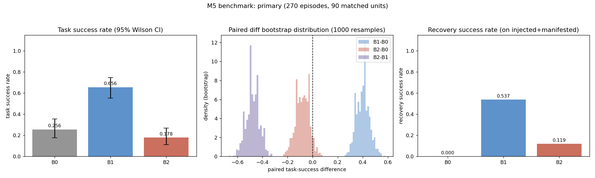

# Robotic Skill Harness: Reliable Manipulation through Fault Detection, Recovery, and Reproducible Evaluation

**Status**: Internal technical report — Milestone 6 (M6). Not peer-reviewed, not published. All figures verified against raw experiment logs; all statistics computed from those logs unless explicitly attributed to an independent lead-audit run.

---

## 1. Abstract

We present **Robotic Skill Harness**, a modular framework for reliable tabletop manipulation on ManiSkill3/SAPIEN with a Franka Panda arm, built around three concerns: *physical fault injection*, *bounded rule-based recovery*, and *reproducible, statistically disciplined evaluation*. The system separates robot control from orchestration through a frozen set of shared interfaces (RobotSkill, SimulatorAdapter, FailureEvent, EpisodeResult) and executes a single pick-and-place skill under a deterministic fault-injection harness.

Across 90 matched fault scenarios evaluated three ways (270 held-out episodes, seeds 100–129, disjoint from all training/validation seeds), a deterministic rule-based recovery stack (**B1**) raises task success from 25.6% (B0, no recovery) to 65.6% — a paired difference of +0.400 (bootstrap 95% CI [0.30, 0.51]). By contrast, a learning-based failure predictor (**B2**), despite a strong offline frame-level PR-AUC of 0.877 (rule baseline 0.618), *reduces* closed-loop success to 17.8%, significantly below B1 (−0.478, CI [−0.58, −0.38]) and statistically indistinguishable from no recovery at all (B2−B0 = −0.078, CI [−0.19, 0.02]). A temporal-gating ablation (B2-T) does not recover the loss (+0.022, CI [0.00, 0.06]).

We diagnose this offline-to-online gap as a mismatch between a *frame-level* ranking metric and *decision-level* utility: the predictor's false positives are amplified into irreversible attempt aborts, exhausting a bounded retry budget, on failures that are only observable *after* the grasp closes within a proprioception-only observation space. We report these results honestly as a negative result with clear scope limits: simulation only, a single task family, three fault classes, oracle-assisted planning, and no real-robot validation.

---

## 2. Introduction & Motivation

Manipulation policies in the real world fail for reasons that are often unobservable at plan time — objects slip, grasps miss, perturbations drift the scene mid-execution. Two complementary engineering responses are common: (i) *detect* failure and *recover* by retrying or replanning, and (ii) *predict* failure before it happens and preempt it. Prediction is attractive because it promises to avoid wasted motion and time; detection-and-recovery is less glamorous but only acts after a failure has already manifested.

This project tests both ideas under controlled, reproducible conditions, and documents a result that matters for practitioners: **a predictor that looks better on offline ranking metrics can make the closed-loop system worse.** The gap is not a bug in any one component but a structural mismatch between what offline metrics reward (per-frame ranking) and what the control loop needs (per-decision correctness, low false-positive cost, actionable lead time). Understanding and quantifying that gap is the core scientific contribution of this report.

Three additional motivations shape the work. First, **reproducibility**: manipulation evaluation is noisy and easy to overfit; we freeze an evaluation protocol before running final experiments and hold out seeds entirely. Second, **honesty about scope**: the system is state-based with oracle-assisted planning, not a vision-based learned policy, and we state this explicitly rather than implying otherwise. Third, **negative results as evidence**: a documented, well-controlled null/negative result (learning preemption does not help under proprioception-only observation) is useful to the community and prevents others from repeating the same expensive mistake.

The concrete research questions addressed are:

1. Does deterministic rule-based recovery improve task success under injected faults, and by how much (with confidence intervals)?
2. Does a learning-based failure predictor, trained with sound episode-level splits and no leakage, improve *closed-loop* success over rule-based recovery?
3. Can temporal decision gating fix the predictor's closed-loop failures?
4. What explains the offline-vs-online performance gap?

---

## 3. Related Tools & System Context

The system is an integration layer over established open-source components; we do not claim novelty in the underlying planners, simulators, or physical models.

| Component | Version | Role |
|---|---|---|
| ManiSkill3 | 3.0.1 | Manipulation environment, Franka Panda, PickCube-v1 task |
| SAPIEN | 3.0.3 | Physics/rendering backend |
| mplib | 0.1.1 | Motion planning (pick-and-place skill) |
| PyTorch | 2.5.1+cu124 | Failure-predictor training/inference |
| gymnasium | 1.4.0 | Env interface |
| numpy | 1.26.4 | Numerical substrate (pinned to avoid an mplib segfault) |

**Task.** PickCube: grasp a cube on the table and place it at a goal pose. The skill uses mplib planning with access to privileged object/goal poses (see §5). This is the *only* task family in the system; StackCube exists in the roadmap but is out of scope for the reported evaluation.

**Fault detection & recovery context.** Prior work on execution monitoring ranges from hand-coded success/failure detectors to learned "failure classifiers" and "anomaly" predictors trained on proprioception or vision. A recurring theme in the literature is that learned failure predictors are usually evaluated with offline frame-level metrics (accuracy, AUC, F1) and only rarely re-measured in closed-loop task success. Our result is a concrete instance of that evaluation gap.

**Reproducibility context.** Manipulation benchmarks are sensitive to seed leakage (train/test overlap through shared random seeds), to fault-injection accounting (was the fault actually applied?), and to the distinction between "the model is better" and "the policy built on the model is better." We address all three explicitly (§6, §8).

---

## 4. System Architecture

The system is decomposed into four specialist roles, each owning a directory, coordinated by a Lead that owns the frozen shared contracts:

| Role | Owns | Responsibility |
|---|---|---|
| A — Simulation | `sim/` | ManiSkill integration, Franka skills, mplib planning baseline, fault injection, dataset collection |
| B — Runtime | `runtime/` | Skill registry, executor, task state machine, failure detector, recovery, predictive guard, structured logging |
| C — Learning | `learning/` | Dataset loading, MLP failure predictor, training/eval, checkpointing |
| D — Evaluation | `eval/` | Metrics, fault-injection accounting, benchmark protocols, baseline comparison |
| Lead | `docs/`, `interfaces/`, `scripts/` | Architecture, frozen contracts, integration, milestone verification |

**Data flow.** ManiSkill env → `SimulatorAdapter` → skill execution → `SkillResult` → runtime state machine → (optionally) `FailureEvent` → recovery; `EpisodeResult` is consumed by the evaluation layer. The learning predictor (role C) consumes only the policy-observation stream and emits a scalar risk that the runtime (role B) turns into a recovery decision.

**Key design decisions.**

1. **No LLM planner.** Control is driven by skills and a state machine; the learning module only predicts failure, never substitutes control.
2. **Single authoritative result.** Each attempt yields exactly one `SkillResult`; the executor does not re-derive success from simulator truth.
3. **Privileged-state isolation.** Planning uses privileged object/goal poses (`privileged_access=True`); failure detection, feature extraction, and the predictor read *only* the policy observation (`obs.policy`), never `obs.truth`. This is a state-based + oracle-assisted system, **not** a vision-based learned policy: `obs_mode="none"`, `policy.images=None`.

**Concurrency & isolation.** Agents work in separate git worktrees on feature branches; shared `interfaces/` contracts are frozen at versioned tags and any change requires Lead approval. Milestones are gated on independently verified execution, not self-reported success.

---

## 5. Robot Skills & Execution Semantics

**RobotSkill** is the unit of executable behavior. Its contract (frozen in `interfaces/`) is:

```text
reset(obs) -> None        # prepare the skill for a fresh attempt
act(obs)    -> action     # return the next action
is_done     -> bool       # completion signal
result(final_obs) -> SkillResult   # single authoritative outcome
```

A `SkillResult` carries exactly one of four statuses:

| Status | Meaning |
|---|---|
| `SUCCESS` | Task goal reached |
| `FAILURE` | Execution failed (may carry an identifiable `FailureEvent`) |
| `TIMEOUT` | Step budget exceeded without success |
| `ABORTED` | Externally aborted |

**Skill completion vs. task success.** These are deliberately distinct concepts in the contract. A skill can *complete* (return a definitive `SkillResult`) while the *task* fails; conversely the executor produces `TIMEOUT`/`ABORTED` independently of the skill. The executor loops until `is_done`, then calls `skill.result(final_obs)` as the single source of truth — it does **not** read simulator success truth directly. This prevents the classic bug where an execution framework and a skill disagree about the outcome.

**PickCubeSkill.** A scripted mplib planner: read cube OBB, build a grasp pose from the cube pose, plan to the goal. It explicitly declares `privileged_access=True` because its `_plan` reads privileged object/goal poses (and, at termination, simulator success truth for early-exit). This is the *oracle/state baseline* — intentionally strong planning so that the recovery layer, not the planner, is the variable under test.

**Execution semantics.** Each episode resets the environment exactly once. Retries within an episode call only `skill.reset(obs)` — never `env.reset` — so recovery always operates on the *same* physics episode with the fault still in effect. This is audited (§6) and is essential to a matched-pair comparison.

---

## 6. Fault Injection & Recovery Design

### 6.1 Physical fault injection

`sim/fault_injection.py` injects **real physical perturbations** (not simulator-flag "failures") and verifies them by reading back physical state after injection:

| Fault | Parameter | Injection step | Recoverable? |
|---|---|---|---|
| `object_displacement` | Δ=[0.07, 0, 0] m | 10 | Yes (replan) |
| `grasp_perturb` | 0.25 rad joint perturb | 25 | Partially (PD absorbs) |
| `object_displacement_large` | Δ=[0.5, 0, 0] m | 10 | No (planning fails → abort) |
| `gripper_drop` (isolated) | sustained, conditional | n/a | Not in main benchmark |

The three main faults are injected at fixed steps and are **deterministic**: the injector uses its own seeded RNG (`np.random.default_rng(seed)`), and two injections with the same (env seed, fault seed, params) reproduce bit-identical deltas and final poses (verified by Agent A's audit). `injected` is determined by reading back the post-injection physical quantity (position delta, velocity delta, joint-angle delta) — **not** by "we called set_pose". `gripper_drop` is a *sustained* fault requiring the cube to be grasped-and-airborne, which the fixed-step scheduler cannot express; it is kept out of the main benchmark and tested independently.

### 6.2 Fault accounting (four-layer eligibility)

| Layer | Definition | M5 held-out result |
|---|---|---|
| eligible | episode reaches the injection step | 270/270 |
| attempted | a `FaultRecord` was produced | 270/270 |
| verified | `injected == True` (physical read-back) | 270/270 |
| manifested | fault caused failure (env fail ∨ FailureEvent ∨ FAILED ∨ recovery triggered) | B0=67, B1=67, B2=84 |

**Important asymmetry.** B2 manifests *more* failures (84) than B0/B1 (67) on the *same* matched scenarios. The extra 17 are self-induced: the predictor aborts attempts on episodes where B1 succeeds without needing recovery. This is direct evidence of harm, not of harder faults.

### 6.3 Rule-based failure detection

`runtime/failure_detector.py` is a deterministic detector reading **only `obs.policy`** (never `obs.truth`): it flags `INVALID_OBS`, `COLLISION` (excess joint velocity), `GRIP_FAIL` (gripper closed but no grasp), and `DROP` (grasped object fell). The canonical failure signal for grasp-fail is `gripper → 0` (gripper closed on empty space).

### 6.4 Bounded recovery

`runtime/recovery.py` implements a rule-based, bounded-retry state machine (`max_retries = 2`): on failure it replans the skill from the current state and re-executes, and aborts safely when the budget is exhausted or the environment ends. The runner resets the environment exactly once per episode (§5); each retry is `skill.reset` only. The recovery decision is the same for B1 and B2 — only the *trigger* differs:

| Variant | Recovery trigger |
|---|---|
| **B0** | None (no recovery; raw baseline) |
| **B1** | Rule detector (post-hoc: failure already manifested) |
| **B2** | Learned predictor (preemptive: risk ≥ 0.5, single-frame trigger) |
| **B2-T** | Learned predictor + frozen phase gate (gripper-closed ≤ 0.5) |

All variants share the same skill, the same observation stream, the same `max_retries=2` safety budget, and the same fault schedule — so differences are attributable to the recovery layer alone.

---

## 7. Learning-Based Failure Prediction

### 7.1 Data & labels

Dataset (M4-A): 150 episodes (76 success / 74 failure, 11,423 frames) over four scenarios (normal 60, object_displacement 30, grasp_perturb 30, object_impulse 30), collected with fault injection and **no recovery** (B0-style), so failures are natural consequences of faults. Degenerate seeds (cube spawning at goal → 1-step trivial success; mplib planning failure → 0 steps) are filtered.

**Labeling.** Frames in the last `H=20` steps of a failed episode are labeled positive (1); all frames of successful episodes are 0. Labels are computed *offline from full-episode outcomes*; model inputs use only current/past observations — no future leakage.

### 7.2 Model

`MLP(22 → 32 → 1)` (769 parameters) over a 22-dim **proprioception-only** feature vector: `qpos(7) + qvel(7) + gripper(1) + tcp_pose(7)`, read exclusively from `obs.policy`. Weighted BCE with `pos_weight=8.61`; input normalization computed on the train split only.

### 7.3 Splits (leakage control)

Episode-level split with **seed atomicity** and a **held-out perturbation type** (`object_impulse`): all 30 object_impulse episodes go to test, which measures generalization to an *unseen fault type*. The original dataset reuses seeds across fault types, so seeds are re-mapped to unique IDs before splitting.

| Split | Episodes | Frames | Positive frames |
|---|---|---|---|
| train | 86 | 6,461 | 672 |
| val | 17 | 1,313 | 126 |
| test (held-out object_impulse) | 47 | 3,649 | 756 |

### 7.4 Offline results (frame-level)

| Metric | Learned (τ=0.5) | Rule baseline | Majority |
|---|---|---|---|
| **PR-AUC** | **0.877** | 0.618 | 0.214 |
| Precision | 0.664 | 0.549 | — |
| Recall | 0.921 | 0.991 | 0.0 |
| F1 | 0.772 | 0.707 | 0.0 |
| False-positive rate | 0.122 | 0.213 | 0.0 |
| Missed failure episodes | 1 / 36 | 0 / 36 | 36 / 36 |

The learned model ranks frames better than the rule (higher PR-AUC, lower FP rate at matched recall) because it uses qvel/tcp context to distinguish "gripper closing on the cube" from "gripper closing on air." At the operating threshold `τ=0.5` it has a 12.2% frame-level false-positive rate (vs. 21.3% for the rule).

### 7.5 Closed-loop integration

`runtime/predictive.py` (`PredictiveGuard`) runs the predictor per-step and, when risk ≥ threshold *and* confidence ≥ a minimum, triggers an early abort-and-retry through the **same** `RecoveryManager.decide` path used by B1 (max_retries enforced). The guard only decides *whether to retry early* — it emits no low-level actions and cannot bypass safety. On inference errors or invalid inputs it falls back to rule behavior. The closed-loop operating threshold is `τ=0.5` (the more robust of the two candidates; `τ=0.35` tuned on the small val set over-triggers at test, FP rate 0.258).

---

## 8. Evaluation Methodology

### 8.1 Protocol (frozen before final runs)

The benchmark protocol is frozen (tag `v0.4.0`) *before* running final experiments; evaluation criteria cannot be adjusted after seeing results. Seeds are assigned to disjoint pools to prevent leakage:

| Pool | Seeds | Purpose |
|---|---|---|
| Training | 0–29 | Predictor training data |
| Old M4 benchmark | 0–9 | Historical (overlaps training — legacy) |
| M5 validation | 40–59 | Temporal-gating parameter selection only |
| **M5 held-out test** | **100–129** | Final evaluation (never used for tuning) |

### 8.2 Matched-pair design

For each of 90 matched units (3 faults × 30 held-out seeds), every variant (B0/B1/B2, and B2-T) is executed once **on the same (fault, seed)**, so differences are computed at the *pair* level. This gives 270 primary episodes (90 × 3 methods). This 270 is a coincidence with the 270 pytest tests (§8.5); the two numbers are unrelated and must not be conflated.

### 8.3 Metrics (explicit denominators)

Every rate reports raw numerator, denominator, and percentage. Primary: `task_success_rate` and `paired task-success difference`. Secondary: `recovery_success_rate` (on injected+manifested), `verified_fault_injection_rate`, `false_recovery_trigger_rate`, `avg_retries`, `abort_rate`, cumulative reward, episode length, wall-clock, `fault_detection_latency`, `early_warning_lead_time`.

### 8.4 Statistics

- **Success rates**: 95% Wilson score intervals (valid for proportions near 0/1).
- **Paired differences**: paired bootstrap, 1000 resamples over matched units, 2.5/97.5 percentiles.
- **Clustered robustness**: a seed-level clustered bootstrap (30 seed clusters, 2000 resamples, run independently by the lead) confirms the headline conclusions: B1−B0 +0.400 CI [0.356, 0.456]; B2−B1 −0.478 CI [−0.578, −0.378].
- Significance is claimed only when the CI excludes 0.

### 8.5 Automated tests vs. evaluation episodes (distinct)

- **275 automated tests** = 270 pytest tests (42 interfaces/contracts + 94 runtime + 134 eval) + 5 simulator fault tests (`sim/test_faults.py`).
- **270 evaluation episodes** = 90 matched units × 3 methods.
These are coincidentally equal and are **different things**: one is unit/integration coverage, the other is simulation evaluation volume.

### 8.6 Reproducibility

```bash
source scripts/activate_env.sh && export CUDA_VISIBLE_DEVICES=2
# primary benchmark (chunked to avoid an mplib GIL crash ~90 eps/process):
for start in 100 105 110 115 120 125; do
  python scripts/verify_m5.py --tag primary \
    --seeds $(seq $start $((start+4))) \
    --faults object_displacement grasp_perturb object_displacement_large
done
# B2-T ablation:
for start in 100 105 110 115 120 125; do
  python scripts/verify_m5.py --tag b2t \
    --seeds $(seq $start $((start+4))) \
    --faults object_displacement grasp_perturb object_displacement_large \
    --methods b2t --no-figs
done
python scripts/compare_b2t.py --b2 logs/m5_primary_episodes.jsonl --b2t logs/m5_b2t_episodes.jsonl
```

Raw artifacts: `logs/m5_primary_episodes.{csv,json,jsonl}`, `logs/m5_primary.json` (aggregates + CIs + bootstrap), `logs/m5_primary_figure.png`, `logs/m5_b2t_episodes.jsonl`, `logs/m5_b2t_comparison.json`, `logs/m4_benchmark.json`.

---

## 9. Results & Ablations

### 9.1 Primary result (90 matched units, 270 episodes, held-out seeds 100–129)

| Metric | B0 (no recovery) | B1 (rule recovery) | B2 (learned preempt) |
|---|---|---|---|
| task_success | 23/90 = **25.6%** | 59/90 = **65.6%** | 16/90 = **17.8%** |
| 95% Wilson CI | [17.7%, 35.4%] | [55.3%, 74.6%] | [11.2%, 26.9%] |
| recovery_success (inj+manifested) | 0/67 = 0% | 36/67 = **53.7%** | 10/84 = **11.9%** |
| abort_rate | 0% | 34.4% (31/90) | 82.2% (74/90) |
| avg_retries | — | 1.42 | 1.89 |
| manifested | 67 | 67 | 84 |

**Paired task-success differences (paired bootstrap, 1000 resamples):**

| Comparison | Mean | 95% CI | Conclusion |
|---|---|---|---|
| B1 − B0 | **+0.400** | [0.300, 0.511] | significant gain (CI > 0) |
| B2 − B1 | **−0.478** | [−0.578, −0.378] | significant loss (CI < 0) |
| B2 − B0 | −0.078 | [−0.189, 0.022] | not significant (CI includes 0) |
| B2-T − B2 | +0.022 | [0.000, 0.056] | not significant (CI touches 0) |

**Figure 1** (`logs/m5_primary_figure.png`): three panels — (left) task success rate with Wilson error bars; (center) paired-difference bootstrap distributions (B1−B0, B2−B0, B2−B1) against the zero line; (right) recovery success rate on injected+manifested failures.



*Interpretation.* Rule-based recovery is robustly and significantly beneficial (+0.400, a 2.6× relative gain over baseline). Learned preemption does not merely fail to help — it *significantly* hurts relative to rule recovery and is statistically indistinguishable from doing nothing. The learned predictor cancels out essentially all of the recovery benefit.

### 9.2 B2-T temporal-gating ablation

Agent B implemented four temporal-decision variants (debounce K=3/5, phase-aware gating, cooldown, advisory-only), selected the phase gate on validation seeds 40–59, froze it (`FROZEN_B2T_GATE`), and evaluated on held-out 100–129:

| Metric | B2 (single-frame) | B2-T (phase gate) |
|---|---|---|
| task_success | 16/90 = 17.8% | 18/90 = 20.0% |
| 95% Wilson CI | [11.2%, 26.9%] | [13.0%, 29.4%] |
| total triggers | 166 | 161 |
| abort | 74/90 | 72/90 |
| recovery_success | 10/84 | 11/83 |

The phase gate changes almost nothing (+0.022, CI just touches 0). **B2's failure is not a temporal-decision-tuning problem; it is an observability-and-cost problem.** No tested gating strategy repairs it.

### 9.3 Supporting diagnostics

| Diagnostic | Value | Meaning |
|---|---|---|
| false_recovery_trigger_rate | 17/67 = **25.4%** | predictor triggered where matched B1 succeeded on first attempt |
| early_warning_lead_time | **21.3 steps** (61 pairs) | B2 first-trigger vs. B1 first-failure; "early" but during grasp-approach |
| B2 total triggers | 166 (~1.84/episode) | ~2 preemptive aborts per episode |
| fault_detection_latency | B1: 66.2 steps; B2: 43.9 steps | B2's earlier "detection" is a false alarm, not an earlier true failure |

### 9.4 Offline vs. online (the gap, quantified)

| Level | Learned predictor | Rule detector |
|---|---|---|
| Frame ranking (offline PR-AUC) | **0.877** | 0.618 |
| Frame F1 @ τ=0.5 | **0.772** | 0.707 |
| Frame FP rate @ τ=0.5 | **0.122** | 0.213 |
| Closed-loop task success | **17.8%** | **65.6%** |

The predictor is *better at ranking frames* and *worse at driving the task*. This inversion is the central finding and is explained in §10.

### 9.5 Preliminary (M4) benchmark

Before the held-out M5 protocol, a smaller benchmark (30 episodes, seeds 0–9, three faults) already exhibited the same pattern: B0 0.233, B1 0.700, B2 0.167 (`logs/m4_benchmark.json`). The M5 held-out run (seeds 100–129, disjoint from training) reproduces and strengthens the finding with proper leakage control, so the conclusion is not an artifact of seed overlap.

---

## 10. Discussion & Limitations

### 10.1 Why a better offline model hurts closed-loop performance

The inversion is not a failure of the *predictor as a ranking model*; it is a failure of the *system that acts on the predictor's output*. Seven distinct factors combine:

1. **Frame-level prediction vs. action-level decision.** PR-AUC rewards the ordering of frames by risk; the control loop needs a *correct binary decision at the right moment*. A model that is "right on average" across 3,649 frames can be wrong at the specific frames where a decision must be made. The metric and the objective are misaligned.

2. **False-positive accumulation.** At τ=0.5 the predictor fires on ~12% of *negative* frames. An episode spans tens of frames, and every single-frame exceedance triggers an abort (no debounce in B2). A per-frame FP rate of 12% becomes a per-episode false-trigger probability near certainty across a long episode — B2 averages 1.84 triggers per episode.

3. **Intervention cost.** A false trigger is not a free "extra check": it aborts the current attempt *irreversibly*. The attempt is wasted and must be replanned from a perturbed state.

4. **Retry-budget exhaustion.** `max_retries=2` caps attempts. Two or three false triggers consume the entire budget, forcing an abort — hence B2's 82.2% abort rate. The predictor's false positives, not the faults, become the dominant cause of termination.

5. **Limited observability.** The 22-dim feature vector is proprioception-only; it contains *no* object pose (object state is in `obs.truth`, off-limits to the predictor). A grasp failure is precisely "gripper vs. object relative pose is wrong" — information that proprioception cannot see *before* the grasp closes.

6. **Delayed failure evidence.** Because of (5), the failure signal is only observable *after* the gripper closes on air (`gripper → 0`). The rule detector (B1) therefore only fires once failure has actually manifested, and it wastes nothing. The predictor's apparent 21-step "lead time" is spent in the grasp-approach/closure window, where "about to grasp" and "about to miss" are proprioceptively indistinguishable — so the "early" trigger is a false alarm at a moment when no corrective action is actually justified.

7. **Recovery actionability.** A predictor only helps if an early trigger enables a *useful* intervention. Here the intervention is "abort and retry the same oracle planner." When the planner would have succeeded anyway (25.4% of cases), the trigger is pure harm; when it would have failed anyway (unrecoverable large displacement), the trigger cannot help. Only the narrow band where early replanning changes the outcome would benefit — and the predictor's false alarms swamp that band.

**Distinguishing the model from the policy.** The learned model *is* a better frame-level failure *predictor* than the rule (0.877 vs. 0.618 PR-AUC, lower FP at matched recall). The *policy that consumes it* (single-frame, unbounded-abort, fixed-retry-budget) is what converts that ranking advantage into closed-loop harm. A different decision policy — e.g., a higher threshold, debouncing, advisory-only preemption, or a *different observation space* — could in principle yield a different outcome. We tested threshold and gating (τ=0.8 still worse; τ=0.95 degrades to rule behavior; phase gating +0.022), but we have **not** tested vision-based observation, which is the most plausible way to give the predictor genuine lead time.

### 10.2 What we do NOT claim

- We do **not** claim learning-based failure prediction is universally ineffective. The result is specific to proprioception-only observation of *post-hoc-observable* grasp failures.
- We do **not** claim rule-based recovery is globally or theoretically optimal — only that it is reliably better than nothing and better than this predictor on these faults.
- We do **not** claim all temporal-decision strategies are exhausted — only the four gating variants we implemented.
- We do **not** describe the robot as using visual observation. The controller uses privileged state (object/goal pose) for planning; the predictor uses proprioception only; `obs_mode="none"`.
- We do **not** claim transfer to real hardware.

### 10.3 Limitations (explicit)

- **Simulation only** (ManiSkill3/SAPIEN); no sim-to-real validation.
- **Single task family** (PickCube place-at-goal); a restricted set of three benchmark faults (plus an isolated sustained fault).
- **Oracle/state-based planning** (`privileged_access=True`): the baseline skill reads privileged poses, so results describe a recovery-layer comparison, not a full learned-policy system.
- **Proprioception-only predictor**: 22-dim policy features, no vision/depth; the head-start limitation is structural, not incidental.
- **Small training set** (150 episodes; test is 47 episodes / 3,649 frames; val only 17 episodes, so threshold tuning is unreliable).
- **Two coincidental "270"s** (tests vs. episodes) — kept distinct throughout.
- **No peer review / publication.** This is an internal milestone report.

### 10.4 Honest negative result

The headline negative result is a *feature* of this report, not a failure of the project: a well-controlled experiment showing that a stronger offline model can hurt a closed-loop system, with a quantified mechanism. We present it in full, including the numbers that make our own learned component look bad (17.8% vs. 65.6%), because suppressing them would mislead.

---

## 11. Conclusion

Robotic Skill Harness demonstrates a reproducible pipeline for reliable manipulation: deterministic physical fault injection, rule-based bounded recovery, and statistically disciplined matched-pair evaluation over held-out seeds. Rule-based post-hoc recovery reliably lifts task success from 25.6% to 65.6% (+0.400, CI [0.30, 0.51]) across 90 matched fault scenarios.

The learning component's result is an honest negative: a proprioception-only predictor with a strong offline PR-AUC (0.877 vs. 0.618 rule baseline) *reduces* closed-loop success to 17.8%, significantly below rule recovery, because frame-level ranking advantage is converted into irreversible attempt aborts that exhaust a bounded retry budget on failures that are only observable after the grasp closes. Temporal gating does not repair this (+0.022, not significant).

The actionable takeaways are: (1) rule-based detection-and-recovery is a robust, cheap reliability primitive worth having; (2) offline frame-level metrics must be re-validated as *decision-level* metrics before a predictor is trusted in a control loop; and (3) if learned preemption is to have real value here, the observation space must change (vision/depth), not the decision gating. The experiment is fully reproducible from frozen protocols and raw logs, and its scope limits are stated without overreach.
